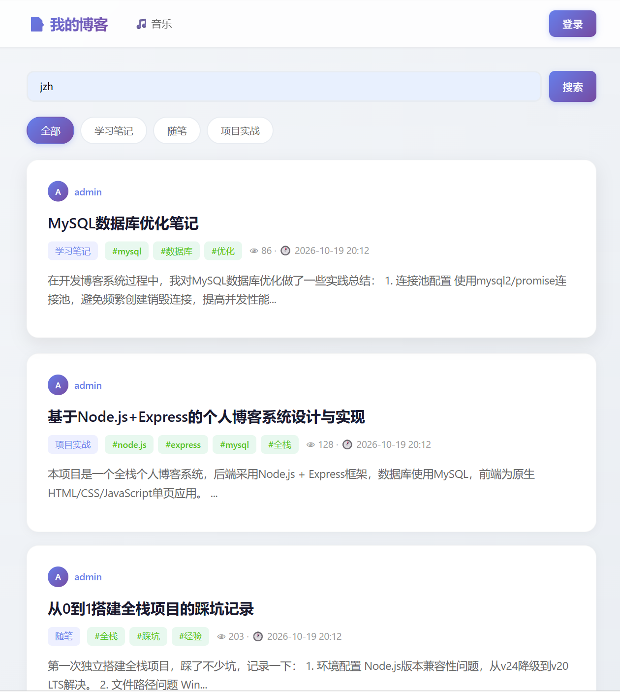
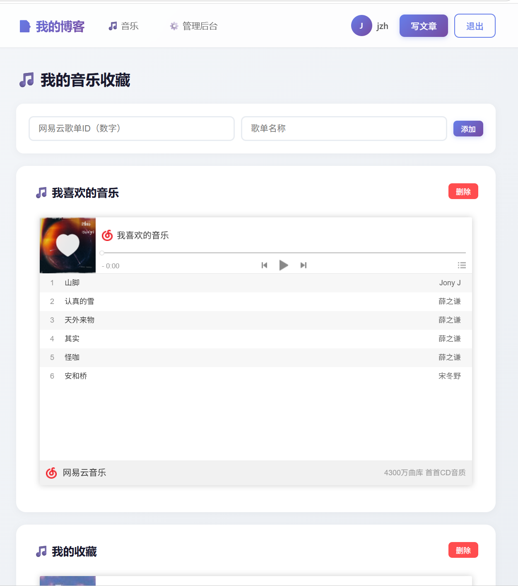
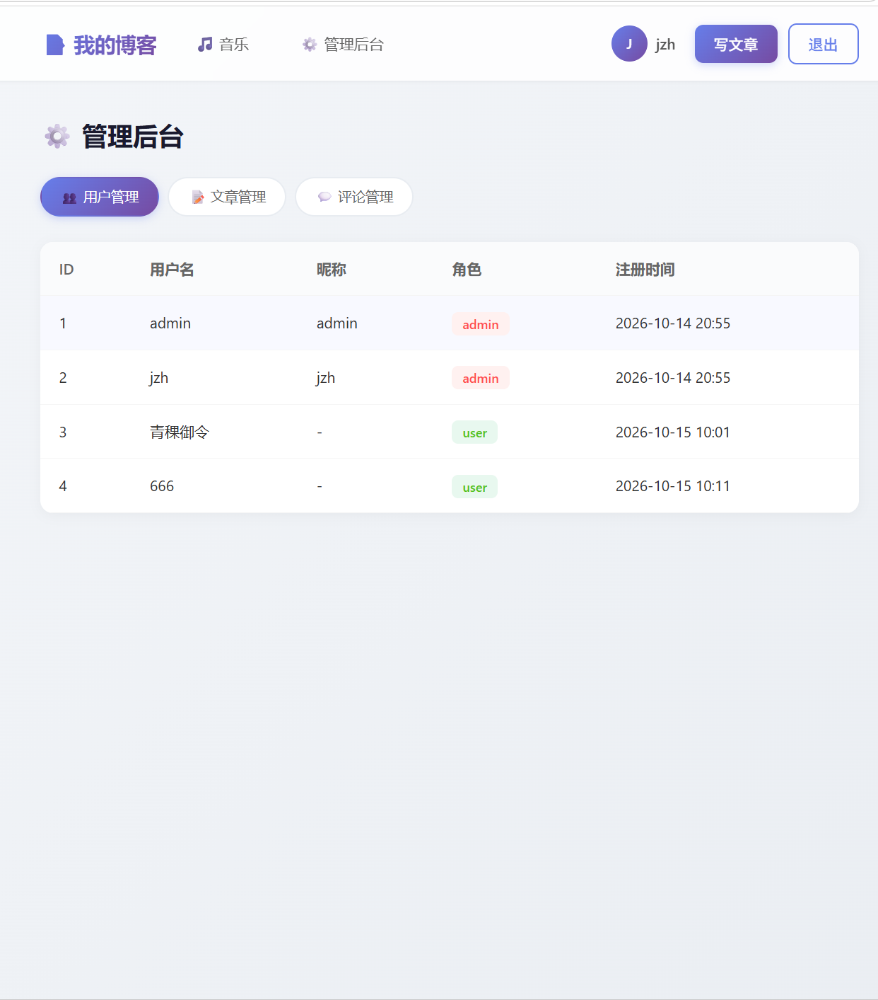

# 📝 Full-Stack Blog 全栈个人博客

基于 **Vue3 + Node.js/Express + MySQL** 的前后端分离个人博客系统。实现了完整的用户鉴权、文章与评论管理、音乐板块以及管理员后台，采用 JWT 无状态鉴权 + bcrypt 密码加密。

> 技术栈：Vue3 ｜ Element Plus ｜ Pinia ｜ Node.js ｜ Express ｜ MySQL ｜ JWT ｜ bcrypt ｜ RESTful API

---

## 🖥 界面预览

### 首页 · 文章列表



文章卡片流，支持关键词搜索、按分类（学习笔记 / 随笔 / 项目实战）筛选，展示作者、标签、阅读量与评论数。

### 🎵 音乐板块



通过网易云歌单 ID 一键嵌入歌单播放器，在线浏览与播放收藏音乐，支持管理自己的歌单。

### 🛠 管理后台



基于角色的权限管理：管理员登录后可进入后台，集中管理全站**用户、文章、评论**；普通用户无权限入口。

---

## ✨ 核心功能

### 用户与权限
- 用户注册 / 登录 / 退出，JWT 无状态鉴权，登录态本地持久化
- bcrypt 加盐哈希加密存储密码，数据库不存明文
- **角色权限（RBAC）**：`admin` 管理员与 `user` 普通用户分级，后端接口校验角色，非管理员无法访问后台

### 文章模块
- 文章发布、编辑、删除、查看（完整 CRUD）
- 分类管理、话题标签、阅读量统计、评论数统计
- 关键词搜索 + 分类筛选

### 评论模块
- 登录用户发表评论，后台可审核 / 删除违规评论

### 音乐板块
- 接入网易云歌单，通过歌单 ID 嵌入官方播放器
- 管理个人收藏歌单

### 管理后台
- 用户管理：查看所有注册用户及其角色
- 文章管理：查看 / 删除全站文章
- 评论管理：查看 / 删除全站评论

---

## 🛠 技术栈

| 端 | 技术 |
| --- | --- |
| 前端 | Vue3（组合式 API）、Vue Router、Pinia、Axios、Element Plus |
| 后端 | Node.js、Express、JWT、bcrypt、cors、dotenv |
| 数据库 | MySQL（云端托管，SSL 连接） |
| 工程化 | Git / GitHub、.env 环境变量管理 |

---

## 🚀 快速启动

```bash
# 1. 安装依赖
npm install

# 2. 初始化数据库（默认库名 blog_db，连接配置见 db.js）
mysql -u root -p < init.sql

# 3. 启动服务（前端页面与接口同一端口）
node app.js
```

启动后访问 <http://localhost:3000>，接口前缀为 `/api`。

> 数据库连接信息在 `db.js` 中配置（host / user / password / database）；
> 示例文章可通过 `seed_articles.sql` 导入。

---

## 🗺 Roadmap

- [ ] 用户个人主页与头像上传
- [ ] 作者本人权限校验（仅作者可编辑自己文章）
- [ ] 深浅主题切换
- [ ] XSS 防护与表单双重校验

---

## 📄 License

MIT
